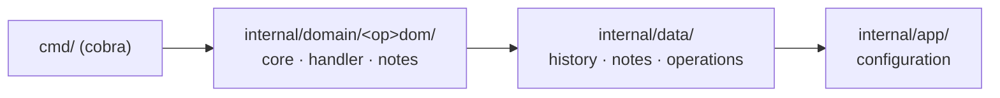

<h1 align="center">
  crower
</h1>

<p align="center">A cross-platform terminal file manager and command-alias manager that keeps an undoable history and per-item notes.</p>

<p align="center">
  <a href="https://github.com/fiwon123/crower/actions/workflows/ci.go.yml"></a>
  
  <a href="https://github.com/fiwon123/crower/blob/main/LICENSE"></a>
</p>

---

## Table of contents

- [About](#about)
- [How to use](#how-to-use)
- [Install](#install)
- [Commands](#commands)
- [Architecture](#architecture)
- [Repository](#repository)
- [How to develop](#how-to-develop)
- [Troubleshooting](#troubleshooting)
- [Tech stack](#tech-stack)
- [License](#license)

## About

crower is a dev tool for the terminal. It stores the commands you run often
under short names, and it manages files and folders the same way — with an
operation history you can step back through, and a note attached to any item.

Everything it stores lives in a TOML configuration file under your home
directory, so it follows you between machines and never touches your project
repositories. The `cr` short alias ships next to the `crower` binary, because a
name you type many times a day should be short.

**Supported platforms**: Windows (commands run through `cmd`) and Linux
(commands run through `sh`).

> **Status**: actively used, pre-1.0. The test suite is small and one package
> is red on machines without a desktop file opener — see
> [How to develop](#how-to-develop).

## How to use

1. Install the binary (see [Install](#install)), or run it from source with
   `go run ./ --help`.
2. Store a command you run often:

   ```bash
   crower create "say-hi" "'echo hello there'"
   ```

   The command is now a first-class name. Run it by the name, by any alias you
   gave it, or by its short form.

3. Create a file or a folder the same way — crower works out which one you meant
   from the path:

   ```bash
   crower create "./notes/todo.md"
   crower create "./notes/archive"
   ```

4. Find what you stored:

   ```bash
   crower list
   crower search "todo"
   ```

5. Undo what you did, one step at a time, or put a specific item back:

   ```bash
   crower revert
   crower restore
   ```

Every operation is recorded. `crower list` shows the history, and `crower
revert` steps back through it.

## Install

Download the archive for your platform from the
[releases page](https://github.com/fiwon123/crower/releases), then run the
installer it ships with:

| Platform | Archive | Install |
|---|---|---|
| Linux | `*.tar.gz` | `tar -xzf <archive> && cd <folder> && ./add_to_path.sh` |
| Windows | `*.zip` | `Expand-Archive <archive>` then `.\add_to_path.bat` |

Each archive carries both `crower` and the short alias `cr`, so `cr create ...`
works the moment the folder is on your PATH.

## Commands

| Command | What it does |
|---|---|
| `crower create` | create a command, file, or folder |
| `crower list` | list commands, history, processes, folders, system, and PATH |
| `crower update` | update an existing command |
| `crower delete` | delete a command, file, or folder |
| `crower reset` | reset all commands |
| `crower search` | search files, folders, and the browser |
| `crower open` | open the configuration file, a path, a folder, or the system |
| `crower execute` | execute a stored command |
| `crower copy` | copy a file or folder to another location |
| `crower move` | move a file or folder to another location |
| `crower extract` | extract compressed files (`.zip`, `.tar`, `.tar.gz`, `.7z`, `.rar`) |
| `crower revert` | revert the history by one step |
| `crower restore` | restore a specific command |

`crower create` without arguments is interactive. Run `crower <command> --help`
for the flags of any command.

## Architecture

Each operation is its own package, so a new operation is a new package rather
than a new branch in a shared handler.



## Repository

- **Source**: https://github.com/fiwon123/crower
- **Releases**: https://github.com/fiwon123/crower/releases
- **Issues & discussions**: https://github.com/fiwon123/crower/issues
- **Wiki**: https://github.com/fiwon123/crower/wiki

## How to develop

### Prerequisites

- Go 1.25.4 or newer (the version is pinned in `go.mod`)
- `make`
- OpenCode — see `AGENTS.md` for how the agent layer is configured

### Quick start

```bash
git clone https://github.com/fiwon123/crower.git
cd crower
go run ./ --help
```

### Commands

| Command | What it does |
|---|---|
| `make check` | gofmt, vet, test, build — the local gate |
| `make release` | build the Windows and Linux release archives into `build/` |
| `make clean` | remove `build/` |
| `go test ./...` | tests only |
| `gofmt -l .` | list files that are not formatted |

### A note on what `make check` proves

`make check` runs gofmt, vet, test, and build. It is red on arrival:
`internal/domain/opendom` fails on any machine without a desktop file opener,
including CI runners. That is a known, tracked failure (issue #45), not a
regression in your change.

Several packages also have no test file at all — `go test` reports those as
`[no test files]` and still exits 0. A green run proves the code is formatted,
vetted, and buildable; it does not prove the behaviour is covered.

Note that running the suite creates and removes `$HOME/crower/test`, outside the
repository.

## Troubleshooting

### `crower: command not found`

The installer's job is to add the extracted folder to your PATH. On Linux it
appends to `~/.bashrc`; start a new shell, or source the file by hand:

```bash
source ~/.bashrc
```

### A command does not appear in `crower list`

Check the configuration file the binary is using — `crower open` prints its
path. A different `--config` path means a different store.

### `crower open` does nothing on a headless machine

`crower open` hands the path to the desktop's file opener. On a server or in a
container there is none, so nothing opens. This is also why the `opendom` test
fails there.

## Tech stack

| Layer | Technology |
|---|---|
| Language | Go 1.25.4 |
| CLI | spf13/cobra |
| Configuration | TOML (pelletier/go-toml) |
| Self-update | minio/selfupdate |
| Platform utilities | shirou/gopsutil |

## License

MIT — see [LICENSE](LICENSE). The Apache-2.0 dependencies are attributed in
[NOTICE](NOTICE), and their licence text ships in
[LICENSE-APACHE](LICENSE-APACHE).
